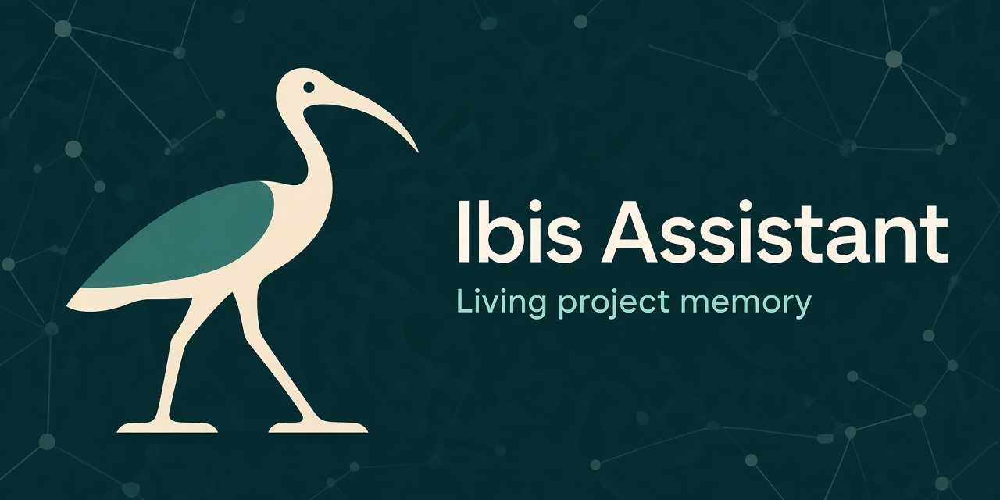

<p align="center">
  
</p>

# Ibis Assistant

**MCP knowledge graph for real codebases** — one executable, auto-wired runtime, then living project memory on that graph.

What the memory wave usually skips is the hard part: turning a messy, polyglot working tree and production logs into a queryable graph. Ibis does that first — Git causality, **ast-grep** structure, **AI-synthesized AST rules** for sparse/legacy languages, log analysis that prefers static matches and can **promote new patterns back into rules** — then stores team decisions and session state in the **same** SurrealDB, retrieved with hybrid search (vector + time + keywords + graph).

**Onboarding is the other half of the product:** download **one** binary; first run runs a **fast** (or **full**) wizard; SurrealDB, Ollama, and the ast-grep sidecar **download/start on demand**; configure AI keys and memory from the **browser Settings UI** or **Ibis: Open Settings** in Cursor/VS Code — not an ENV scavenger hunt or a Docker compose novel.

Client-agnostic MCP (Cursor, VS Code, Claude Desktop, CLI). Personal daemon **or** team server. Local-first hybrid AI (Ollama; AMD/NVIDIA). Not a SaaS memory marketplace and not an agent OS.

**Guides:** [polyglot AST & rule synth](docs/code_ingest_polyglot_and_rules.md) · [log pipeline](docs/log_analysis_pipeline.md) · [AI & Settings / wizard](docs/ai_and_settings.md) · [commit-meaning temporal](docs/commit_meaning_temporal.md) · [memory](docs/memory_layer.md) · [competitive landscape](docs/competitive_memory_landscape.md) · [runtimes](docs/runtime_modes.md)

## Why Ibis (vs the memory wave)

We compared **Recallium**, **mem0**, **RepoMemory**, **agentmemory**, **Unibase/Membase**, and **Letta**. They compete on *remembering chat/agent state*. Ibis competes on **understanding the project**, then remembering on that substrate. Useful memory ideas (typed kinds, supersession, session load) were absorbed; we did **not** become a generic memory API or agent runtime.

| | **Ibis Assistant** | Recallium | mem0 | RepoMemory | agentmemory | Membase / Unibase | Letta |
|--|--------------------|-----------|------|------------|-------------|-------------------|-------|
| **Primary job** | Code/git/log/ticket **graph** + living project memory | Dev memory MCP | General agent memory API / cloud | Citation-first repo evidence | Claude-oriented memory MCP | Ledger / attestation memory | **Agent runtime** + memory blocks |
| **Polyglot AST ingest** | **ast-grep** + `languageGlobs` for mixed/legacy stacks | No | No | Index / citations, not AST rules | No | No | No |
| **AI rule synthesis** | **Yes** — sparse code rules → validated YAML under `rules/`; logs can promote patterns / generate AST rules | No | No | No | No | No | No |
| **Log → code cause** | Watch / analyze → static+ast-grep first → AI residual → **file/location/cause** report | No | No | No | No | No | No |
| **Git + tickets + PRs** | Native ingest, blast radius, `ticket_*`, `repo_pr_*` | Memory-centric | No | Repo-focused | Limited | No | No |
| **Typed team memory** | Sharing-first `memory_*` on the **same** graph | Typed memory product | User/session/agent facts | Optional team sections | Capture-oriented | Varies | Per-agent blocks |
| **Delivery** | **One Rust binary**: personal / plugin / server | Local MCP | Library + self-host + **hosted** | Local Python / stdio | MCP + host hooks | Separate stack | Framework / cloud |
| **Onboarding** | **Wizard** `config fast` / `full`; **auto-download** SurrealDB / Ollama / `sg`; Settings UI + **Ibis: Open Settings** from IDE; Windows service in one UAC pass | Install + wire MCP | SDK / Docker / cloud signup | Python toolchain | Plugin install per host | Product-specific | Framework setup |
| **Config UX** | Browser `/settings/` + MCP `settings_*` + CLI wizard; keys in `config.json` (not ENV-first) | Varies | API keys / dashboard | CLI-heavy | Host-dependent | Varies | Varies / BYOK |
| **Clients** | Any MCP client | MCP IDEs | SDK / HTTP | MCP + CLI | Claude Code–skewed | Product-specific | Build agents *in* Letta |
| **Local AI** | Ollama embeddings + hybrid chat; cloud optional | Local embeddings OK | Often LLM/cloud path | Standalone OK | Host-dependent | Varies | BYOK / cloud |
| **What we refuse** | SaaS tenancy, blockchain attestation, replacing Surreal, markdown-as-sync, absorbing an agent OS | ELv2 hosting limits | Platform gravity | Read-heavy MCP surface | Single-host depth | Ledger DNA | “Rewrite agents in our runtime” |

**Bottom line:** pick mem0/Letta for agent platforms; Recallium/agentmemory for memory-only MCP; RepoMemory for citation search. Pick **Ibis** when you want **graph + AST/log intelligence** without a stack of sidecars to babysit — one exe, wizard, IDE Settings — then optional sharing-first team memory on that graph.

## What matters most (moat + operability)

1. **Polyglot code ingest with AST rule synthesis** — chunk/call-graph via **ast-grep**, not regex-only; `languageGlobs` for mixed/legacy web hosts; when rules are sparse, AI proposes **validated YAML** persisted under `rules/`. ([docs/code_ingest_polyglot_and_rules.md](docs/code_ingest_polyglot_and_rules.md))
2. **Log analysis that learns structure** — recursive watch → LogAlign / known patterns / **ast-grep** before the LLM; enrich to file + cause; promote repeats; optional **AST rule generation from errors**. ([docs/log_analysis_pipeline.md](docs/log_analysis_pipeline.md))
3. **Unified knowledge graph** — commits → files, issues, authors, chunks, and memories in one SurrealDB; blast radius / dead code / hybrid `ask_project` (HEAD code + **`commit_chunk` change meaning**).
4. **Plug-and-play operability** — single executable; **auto-provision** SurrealDB, Ollama, ast-grep; **`config fast`** (defaults from host hardware) vs **`config full`**; same surface via browser Settings, CLI, and IDE (**Ibis: Open Settings** / `settings_open_ui`, ephemeral loopback token when personal HTTP is down); Windows **`/install`** service in one elevation. Keys live in config — ENV is override only. ([docs/ai_and_settings.md](docs/ai_and_settings.md))
5. **Temporal freshness** — per-commit message+patch embeddings (`commit_chunk`), currentness/visibility gates on typed memory, path-based stale refresh after HEAD ingest. ([docs/commit_meaning_temporal.md](docs/commit_meaning_temporal.md))
6. **Living memory on that graph** — typed, sharing-first `memory_*` (kinds, supersession, working state, capture, local-first consolidate). Memory keeps the graph useful across sessions; it does not replace ingest or commit meaning. ([docs/memory_layer.md](docs/memory_layer.md))
7. **Personal / plugin / server** — live working trees (no clone/`reset --hard` on the developer copy); shared SurrealDB via personal HTTP + `IBIS_MCP_URL` when two IDEs need one brain.

## Plug and play

**Download one binary. Autoconfigure as far as the machine allows. Run.**

1. [Releases](https://github.com/terenzif/ibis-assistant/releases) → put `ibis-assistant` on `PATH` (no Rust toolchain required for normal use).
2. First launch with no `config.json` → interactive **`config fast`** (probe GPU/CPU, pick hybrid/local/cloud, write keys and paths). Use **`config full`** when you also want DB/SMTP/ticketing/timeouts in the same wizard.
3. **On demand:** SurrealDB, Ollama (embeddings + local chat), and the `sg` sidecar install or start when enabled — you should not hand-assemble a compose file for the happy path.
4. Same settings surface everywhere:
   - Browser: `http://127.0.0.1:<port>/settings/`
   - CLI: `ibis-assistant config show` / `config recommend`
   - IDE: **Ibis: Open Settings** (Cursor plugin / VS Code) → MCP `settings_open_ui` (reuses personal HTTP or spins an ephemeral loopback URL with a one-shot token)
5. `ibis-assistant run` (or Windows `/install` for a service) → MCP `POST /mcp`.

Settings covers hybrid AI, cloud keys, local/IDE-provided models, paths, and a **Memory** browser (filter, share, export, optional `.ibis/memory` projection).

## Quick start

```bash
ibis-assistant          # config fast if needed
ibis-assistant run      # MCP + /settings/
```

```bash
ibis-assistant ingest code --path ./path/to/project
ibis-assistant ask "What breaks if Prices changes?" --branch main
ibis-assistant logs analyze --project MyApp --text "ERROR timeout talking to db"
ibis-assistant memory session --project MyApp
ibis-assistant memory add --project MyApp --kind decision --title "MCP transport" \
  --text "Prefer Streamable HTTP at /mcp"
```

```bash
git clone https://github.com/terenzif/ibis-assistant.git
cd ibis-assistant
cargo xtask dist          # dist/ibis-assistant.exe + mcp-bridge + rules + sgconfig
```

Tracked defaults: `config_master.json`. **Never commit** local `config.json`.

```json
{
  "port": 3030,
  "runtime_mode": "personal",
  "projects": [
    { "name": "ibis-assistant", "working_repo_path": "C:/work/ibis-assistant" }
  ],
  "ai": {
    "embedding": { "provider": "ollama", "model": "nomic-embed-text", "auto_start": true },
    "reasoning": { "provider": "hybrid", "model": "auto", "context_only_fallback": true }
  },
  "logs_root": "./logs",
  "memory": { "projection_enabled": false }
}
```

| Runtime | Meaning |
|---------|---------|
| `personal` | Same PC as the repos; `127.0.0.1`; live tree |
| `plugin` | IDE stdio child; `%LOCALAPPDATA%\ibis-assistant\plugin` or `IBIS_DATA_DIR` |
| `server` | Shared host; clones under `discovery_root/dynamic` |

Two IDEs → personal daemon + `IBIS_MCP_URL`. Details: [docs/runtime_modes.md](docs/runtime_modes.md).

## Graph feeders (the uncommon part)

| Capability | What it does |
|------------|----------------|
| **Git ingest** | `commit` → `changed` → `file` causality for “why did this change?” |
| **Polyglot AST** | `sg` + `sgconfig.yml` / `rules/`; embedded regions (e.g. inline script/style in server-page templates) |
| **Rule synthesis** | Sparse extensions → AI YAML → validate → persist; grows the pack over time |
| **Log pipeline** | Watcher + MCP/CLI; static/ast-grep before AI; sidecar report with location/cause |
| **Ticketing / PRs** | Redmine / Jira / Azure DevOps; `ticket_*`, `repo_pr_*` |
| **Server patch sync** | `sync_local_patch` on owned clones; personal/plugin return `live_tree` |

## Memory on the graph

| Need | Use |
|------|-----|
| Prior context | `load_session_context` **once** |
| Durable note | `memory_add` / **Ibis: Remember** |
| Branch scratchpad | `set_working_state` / **Ibis: Set working state** |
| Raw lesson | `capture_observation` (sparingly) |
| Distill | `memory_consolidate` (local-first) |
| Move runtimes | `memory_export` / `memory_import` (team by default) |

Legacy `provide_collaborative_memory` / `save_reasoning_outcome` still write the typed model. Identity rules: [docs/memory_layer.md](docs/memory_layer.md).

## MCP clients

- Streamable HTTP: `http://127.0.0.1:3030/mcp`
- Discovery: `GET /` + `ibis://guide`
- Cursor: [`cursor-plugin/`](cursor-plugin/) — binary on `PATH`, no `${workspaceFolder}` in `mcp.json`
- VS Code: [`vscode-extension/`](vscode-extension/)
- Claude: [docs/CLAUDE_INTEGRATION.md](docs/CLAUDE_INTEGRATION.md) (via `mcp-bridge`)

```json
"mcpServers": {
  "ibis-assistant": { "url": "http://127.0.0.1:3030/mcp" }
}
```

## Commands

| Command | Purpose |
|---------|---------|
| `run` / `start` / `stop` | Server / daemon |
| `config` [`fast`\|`full`\|`show`\|`recommend`] | Wizard & summary |
| `ingest` / `ask` / `logs` / `ticket` / `pr` / `credentials` | Graph & ops helpers |
| `memory …` | Typed memory CLI |
| `outcome` / `optimize` | Outcomes / RAFT (+ consolidation via MCP) |
| `version` · `/install` `/uninstall` | Version · Windows service |

## Prerequisites

**Binary:** Git on `PATH`; cloud keys only if you want cloud reasoning.  
**Source:** Rust stable (MSVC on Windows); SurrealDB/Ollama/ast-grep sidecar can auto-provision.

```bash
cargo test
```

## Product axes

* Deeper polyglot coverage and rule-synth quality (code + logs)
* Stronger local models / AMD ROCm UX; cloud stays adapters
* Memory consolidation and retrieval on top of a richer graph
* **Out of scope:** SaaS tenancy, blockchain attestation, replacing SurrealDB, markdown sync bus, absorbing an agent OS

## Contributors

* Prefer ast-grep rules (+ synth) over regex-only ingest/logs
* Prefer `memory_add` / `capture_observation` / `load_session_context` for durable notes
* Prefer `ticket_*` over legacy `redmine_*` tool names
* `AGENTS.md` local-only; never commit `config.json`

## License

MIT — see [LICENSE](LICENSE).