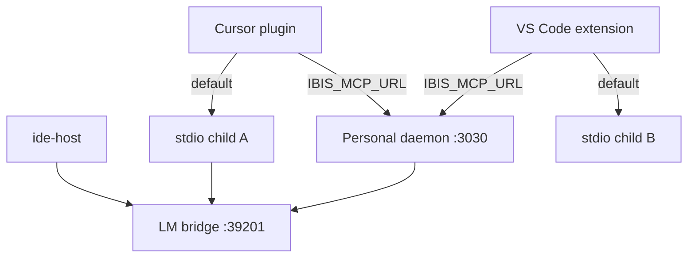

# IDE host, shared runtime, and IDE-provided models

**Date:** 2026-09-20  
**Status:** Implemented across stacked PRs (ephemeral Settings, Cursor plugin surface, `ide-host`, LM bridge, VS Code extension)  
**Primary IDE:** Cursor (`cursor-plugin/`)  
**Secondary IDE:** VS Code (`vscode-extension/`)

## Summary

Ibis does **not** load Go in-process into Cursor or VS Code (no `c-shared` / FFI). A thin Node **ide-host** optionally sits between the IDE and the Go binary:

- **Default:** each IDE spawns its own `ibis-assistant -mode stdio -runtime-mode plugin` child.
- **Shared runtime (optional):** both IDEs attach to one **personal** HTTP daemon via `IBIS_MCP_URL=http://127.0.0.1:3030/mcp`.
- **IDE-provided LLM (optional):** Go `cursor` provider calls a loopback LM bridge; the host wires `vscode.lm` / VS Code Language Model API.

## Architecture

## Runtime uniqueness

| Scenario | Unique process / DB? | Notes |
|----------|----------------------|-------|
| Cursor only, default `mcp.json` | Yes (one child) | Plugin data dir |
| Cursor + VS Code, both default spawn | **No** | Two children; **never** share one SurrealDB silently |
| Both set `IBIS_MCP_URL` → personal `/mcp` | **Yes** | Preferred shared path |
| One owns stdio, other uses host-exported HTTP MCP | Stretch / future | Documented only |

Env:

| Variable | Meaning |
|----------|---------|
| `IBIS_MCP_URL` | When set, ide-host attaches to Streamable HTTP MCP instead of spawning |
| `IBIS_DATA_DIR` | Plugin data dir (isolated spawn only) |
| `IBIS_LM_BRIDGE_URL` | Go → host LM RPC (default `http://127.0.0.1:39201`) |
| `IBIS_BIN` | Override Go executable for spawn |

## Settings UI

- Personal: `http://127.0.0.1:<port>/settings/`
- Plugin stdio: `settings_open_ui` reuses personal when reachable, else **ephemeral** loopback + `?token=`
- Toggle: **Use IDE-provided models when available** → `ai.reasoning.use_ide_provided_models`
- Memory browser + optional **Write memories to `.ibis/memory/*.md`** (`memory.projection_enabled`, default off). SurrealDB remains source of truth. Operator guide: [memory_layer.md](memory_layer.md).

## Shared memory with two IDEs

Typed memory (`memory_*`, `load_session_context`, `capture_observation`, …) is stored in whichever SurrealDB the attached runtime owns.

- **Recommended:** personal HTTP daemon + `IBIS_MCP_URL` so Cursor and VS Code share one memory table (and one consolidation backlog).
- **Isolated plugin children:** each IDE has its own DB; use `memory_export` / `memory_import` to transfer, or promote durable notes via `memory_share` after import.
- Actor attribution: HTTP header `X-Ibis-Actor` or tool arg `actor` (stdio/plugin).

## Packages

| Path | Role |
|------|------|
| [`cursor-plugin/`](../cursor-plugin/) | Cursor primary: MCP, commands, rules, skill, hook, STATUS |
| [`ide-host/`](../ide-host/) | Shared spawn / attach / LM RPC |
| [`vscode-extension/`](../vscode-extension/) | VS Code secondary packaging |
| [`internal/ai/cursor_lm.go`](../internal/ai/cursor_lm.go) | Go bridge client |

## Explicitly rejected / later

| Item | Status |
|------|--------|
| Go in-process via FFI | Rejected |
| Marketplace / Open VSX publish CI | Later (local VSIX first) |
| Native IDE Settings webview | Later (browser ephemeral enough) |
| OAuth MCP, mcp-bridge off SSE | Unchanged out of scope |

## Related

- [runtime_modes.md](runtime_modes.md)
- [ai_and_settings.md](ai_and_settings.md)
- [cursor-plugin/STATUS.md](../cursor-plugin/STATUS.md)
