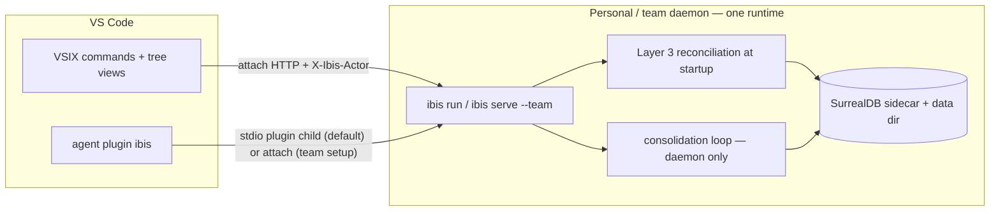

# Memory view + team server: F4 design (VSIX 1.1.0 / runtime 0.3.0)

**Date:** 2026-11-01
**Status:** Approved — owner decisions recorded in [the brainstorm](../planning/memory-view-team-server-brainstorm.md) §6 (A1 `current`, A2 second view, A3 full curation menu, A5 always-on daemon, T1 runbook+serve+compose, T2 settings+header, T4 reconciliation in-phase, phase named **F4**).
**Related:** [memory absorption](specs/2026-10-09-memory-absorption-design.md), [git claim store addendum](specs/2026-10-24-git-claim-store-addendum.md), [ADR claim SoT](specs/2026-10-24-adr-claim-sot-annotative-layer3.md), [sidecar lifecycle plan](../planning/sidecar-lifecycle-plan.md), [memory layer](../memory_layer.md), [runtime modes](../runtime_modes.md), [PLAN.md F4](../planning/PLAN.md).

## Summary

Two milestones, one phase:

- **Milestone A — Memory view** (VSIX `1.1.0`): the activity-bar memory surface grows from a read-only kind browser into a curation workspace: current-only by default, a second **Workstreams** view, full inline curation (Share / Archive / Supersede / Update), and a **single-runtime backend** — the VSIX attaches to an always-on personal daemon instead of spawning its own children.
- **Milestone B — Team server** (runtime `0.3.0`): `ibis serve --team` + official docker-compose + runbook turn the personal daemon into a shareable team runtime; actor identity via settings+header; consolidation runs only in the daemon; sidecar reconciliation (Layer 3) lands as its structural precondition.

Product DNA guardrails carry over unchanged: SurrealDB is the SoT, `visibility` is sharing-first (no row-level ACL, no auth tokens — trust boundary is network reachability), the `.ibis/memory` projection stays regenerable output.

## Architecture

After Milestone A the VSIX owns **zero** long-lived children: the MCP provider contributes a Streamable HTTP definition pointing at the daemon, and every command path (`callMcpTool`) rides the same attach backend with the actor header. The plugin keeps its stdio child by default (it must work daemon-less); on team setups its `mcp.json` is switched to the http variant (runbook).

## Milestone A — Memory view

### A.1 Always-on daemon backend (decision A5)

- New default flow, when `runtime.mode` is **unconfigured** and `IBIS_MCP_URL` is unset: attach to `http://127.0.0.1:3030/mcp` (`DEFAULT_MCP_URL`).
  - Reachable → status bar `Ibis attach`, provider definition `{ type: "http", url }`, all commands attach.
  - Unreachable → status bar `$(error) Ibis daemon offline`; new command **Ibis Assistant: Start Daemon** spawns `ibis run` detached (breakaway from the VSIX job so it outlives VS Code; if breakaway is refused by the host job, fall back to instructing manual start) and re-probes with the existing `probeReachable`.
- Explicit `ibis.runtime.mode=spawn` keeps today's behavior bit-for-bit (back-compat for CI/preview setups; `chat.pluginLocations` smoke flows stay valid).
- `warnDualPluginChildren` message updates: the VSIX no longer spawns a plugin child; the warning targets the plugin spawn + daemon combination with the documented team fix (plugin `mcp.json` http variant).
- The persistent `StdioSession` machinery stays (plugin/stdio contexts and legacy spawn mode); the daemon path reuses `callMcpToolHttp` with one addition: the actor header (B.4).

### A.2 Kind browse defaults to `current` (decision A1)

- New setting `ibis.memory.statusFilter`: `"current"` (default) | `"all"`.
- Kind nodes pass `status: current` to `memory_list` when `current`; view title badge shows `all` when switched; title-bar action + command `Ibis Assistant: Toggle Memory Status Filter`.
- Entry descriptions keep the status badge for non-current rows (needed in `all` mode).
- The Workstreams view (A.3) and search results honor the same filter (search: pass `status` to `memory_search`, which already defaults empty→current — `all` passes the explicit empty/all marker).

### A.3 Workstreams second view (decision A2)

Server (runtime, read-only surface):

- `memory_list` gains optional `workstream` arg (workstream **name or id**): rows filtered by the `part_of_workstream` edge (`id IN (SELECT in FROM part_of_workstream WHERE out = $ws)`), combined with kind/status/visibility filters and limit.
- New read-only tool **`memory_workstreams`** (no args → `[{id, name, status, current_count}]` ordered by most recently touched; annotation `readOnlyHint: true` + title). Tool surface 57 → 58: contract tests, read-only annotation set and discovery fixture updated together.

VSIX:

- Second TreeView **Workstreams** (`ibis.workstreamExplorer`) in the same activity-bar container (two views, one icon — per A2 decision).
- Roots = `memory_workstreams` rows (name + `current_count` in description); children = `memory_list({workstream})` entries honoring the status filter; same detail editor; same error-node degradation pattern.

### A.4 Full inline curation menu (decision A3)

Context menu on entry nodes (`ibisMemoryEntry`); every action surfaces the tool result as a toast with the standard output-channel detail:

| Action | Tool call | Confirmation | Guard |
|---|---|---|---|
| Share (personal↔team) | `memory_share` | none (low risk) | — |
| Archive | `memory_update` `status=archived` | yes | git-owned claims are rejected by the runtime (repo is SoT) — surface the message |
| Supersede… | `memory_add` with `supersedes=<id>`, kind prefilled, visibility prefilled, title + content via input boxes | yes | allowed on **any** memory (governance route for others' team rows) |
| Update content… | `memory_update` `content` (re-embeds) | yes | only offered when `owner === actor`; on governance error offer "create a superseding memory instead" |

Git-owned claims (`store === "git"`) show all actions disabled with the tooltip "repo is source of truth — supersede via `.ibis/claims/` commit".

### A.5 Refresh semantics (decision A4: refresh on focus)

- On view visibility change, refresh expanded kind/workstream nodes via `memory_list` (embedding-free, cheap).
- Search nodes are **never** auto-refreshed (embedding cost); rerunning `Ibis Assistant: Search Memory` re-executes.
- `resources/subscribe` live refresh is explicitly deferred: only revisit if real usage demands it (brainstorm A4).

## Milestone B — Team server

### B.1 `ibis serve --team` (decision T1)

- `ibis serve` = alias of `run` (personal daemon). `--team` is a profile flag: `--bind <addr>` honored (default `127.0.0.1`; team docs use the LAN address), `.ibis/memory` projection **enabled by default** (team-reviewable docs), startup banner lists bind address + actor header reminder.
- No token/auth — trust boundary is network reachability, stated in the banner and the runbook (guardrails).
- `--data-dir` documented for the team host so the team store never mixes with personal plugin data.

### B.2 Official docker-compose (decision T1)

- `deploy/docker-compose.yml` + `Dockerfile`: runtime image with the `ibis` binary, embedded SurrealDB sidecar spawned by the runtime (job object semantics do not apply in containers — the compose restart policy owns recovery), volume for the data dir, ports `3030` (MCP) exposed.
- Image pinned; GHCR publishing deferred until CI wants it.

### B.3 Runbook (decision T1)

`docs/team_server.md`: binary+service install (NSSM/systemd) and compose paths, bind address, actor identity rollout, data-dir backup/restore, upgrade steps, client onboarding (VSIX settings, plugin `mcp.json` http variant, CLI env vars), and the consolidation ownership note (B.5).

### B.4 Actor identity (decision T2)

- VSIX setting `ibis.identity.actor`; in attach mode `postJsonRpc` sends `X-Ibis-Actor: <actor>` on every request (initialize included).
- CLI: `IBIS_ACTOR` env documented (server-side header handling already exists; stdio `actor` arg unchanged).
- The curation menu (A.4) uses the actor for the Update guard; new team rows attribute correctly on shared servers.

### B.5 Consolidation runs in the daemon only (decision T3, implied by A5)

- The consolidation loop is a daemon-side capability, opt-in: `--consolidate` flag / `ai.consolidation.enabled` config (off by default locally; recommended ON in the team runbook with the cron from the plugin automations as the human trigger).
- Client surfaces never start it; duplicate-supersede risk disappears with the single-runtime topology.

### B.6 Reconciliation Layer 3 (decision T4)

At daemon/server startup, **before** spawning sidecars (per the sidecar lifecycle plan §Layer 3):

1. Read the PID ledger in the data dir (per-sidecar pid + start timestamp, written at spawn time).
2. Liveness: `OpenProcess` + start-time match (Windows) / `kill(pid, 0)` + `/proc/<pid>/stat` starttime (unix) — PID reuse excluded by the start-time comparison.
3. Stale sidecars bound to the same data dir/port are terminated before a new one starts; the ledger is rewritten.
### B.7 Personal-claims knob (T5)

- VSIX setting `ibis.claims.personalMode`: `stub` (default) | `db_only` → passed to the runtime as `IBIS_CLAIMS_PERSONAL_MODE` (claim-store addendum §4c: personal mode → stub default; team → db_only). Wizard parity deferred.

## Tests and verification

- **Rust**: `memory_list` workstream filter unit tests (edge direction pinned); `memory_workstreams` contract; reconciliation e2e (spawn sidecar → kill ledger owner → restart detects and kills stale); `serve --team` profile config test; `clippy -D warnings` + `cargo test --workspace`.
- **ide-host**: header-injection test on the http path; existing `session_test.mjs`/`bridge_framing_test.mjs` stay green (stdio machinery untouched).
- **VSIX**: `node --check`; `smoke-plugin.mjs` updated for the second view + new commands + provider definition shape; `vsce package` green.
- **Protocol**: `smoke-mcp.mjs` updated for the 58-tool surface (annotations + discovery fixture).
- **Manual (gate R7)**: after WQ-7 — compose/`serve --team` on LAN against the SurrealDB **`v4.0.0`** image (greenfield data volume), 2+ real clients attached (VSIX + plugin), actor attribution visible on shared rows, no duplicate consolidation runs, daemon restart cleans stale sidecars. A `v3.3.5` pretest does not close the gate ([team_server.md §8](../team_server.md)). **Closed 05/11**: scripted pass green 0–5 on the certified `v4.0.0` image, interactive owner pass on both real clients (VSIX attach + plugin http), LAN multi-host extension — evidence `.r7-pretest/r7-gate-checklist.out.txt` (local, gitignored).

## Proposed commits (1 per sub-phase, repo style)

| Sub | Content | Commit |
|---|---|---|
| F4-B1 | reconciliation Layer 3 (ledger + liveness + start-time) | `feat(runtime): sidecar reconciliation at startup (layer 3)` |
| F4-B2 | `ibis serve --team` profile + bind + projection default | `feat(cli): serve --team profile with lan binding` |
| F4-B3 | daemon-only consolidation opt-in | `feat(daemon): consolidation loop owned by the daemon` |
| F4-B4 | docker-compose + Dockerfile + runbook docs | `feat(deploy): team server compose and runbook` |
| F4-A1 | daemon attach default + Start Daemon + provider http definition | `feat(vscode): attach to the personal daemon by default` |
| F4-A2 | statusFilter current/all | `feat(vscode): memory tree status filter (current default)` |
| F4-A3 | memory_list workstream arg + memory_workstreams tool | `feat(server): workstream browse (memory_workstreams, list filter)` |
| F4-A4 | Workstreams view + curation menu + refresh on focus | `feat(vscode): workstreams view and inline curation menu` |
| F4-A5 | actor identity setting + header injection + claims knob | `feat(vscode): actor identity header and claims mode knob` |

Sequencing: `[S3 publish 1.0.0] → F4-B1..B4 ∥ F4-A1..A5 → WQ-7 (SurrealDB 4 / v4.0.0) → R7 → F3 docs → Track D` — **R7 closed 05/11, F3 docs landed 07/11** (evidence `.r7-pretest/r7-gate-checklist.out.txt`).

## Risks

| Risk | Mitigation |
|---|---|
| Daemon lifecycle confusion (outlives VS Code) | `ibis stop` exists (`daemon.rs`); runbook + banner document start/stop; status bar shows online/offline |
| Plugin child + daemon coexistence (attach to daemon sidecar) | existing attach tolerance; team setup switches plugin to http; reconciliation cleans stale on restart |
| Migration surprise for `runtime.mode=spawn` users | explicit setting honored bit-for-bit; unconfigured default changes only |
| Curation on others' team rows | governance already routes to supersede; menu mirrors it (Update hidden unless owner) |
| Compose without kernel job semantics | restart policy owns recovery; documented in runbook |
| Tool-surface churn (58 tools) | contract tests + discovery fixture updated in the same commit (established pattern) |