# Memory absorption: durable, shareable, temporally-aware memory for Ibis Assistant

**Date:** 2026-10-09
**Status:** Implemented (PR #28) — operator guide: [memory_layer.md](../../memory_layer.md); plan: [plan](../plans/2026-10-09-memory-absorption.md)
**Related:** [report_memory_evaluation.md](../../report_memory_evaluation.md), [research_memory_limits.md](../../research_memory_limits.md), [spec_cognitive_architecture.md](../../spec_cognitive_architecture.md), [runtime_modes.md](../../runtime_modes.md), [2026-09-19-hybrid-reasoning-settings-design.md](2026-09-19-hybrid-reasoning-settings-design.md), [git-indexed world state (proposed Layer 3)](2026-10-24-git-indexed-world-state.md)

**Scope note:** This design’s “temporal” model is **logical currentness** (`status`, wall-clock `valid_from`/`valid_until`, supersession) plus optional file **content-hash** provenance — not multi-truth indexed by git commit. Git DAG `as_of` / `knowledge_diff` is specified separately in the Layer 3 doc above.

## Summary

Ibis Assistant has a `memory` table (free-text "collaborative memory") and a `reasoning` table (question/outcome pairs), both vector-searched from `ask_project`. That is **semantic recall with no structure**: no kind, no current-vs-superseded state, no owner, no team/personal boundary, no link back to the code/commit/issue that produced the memory, and no single low-cost capture path an agent can call on every turn without spamming tools.

This spec absorbs the useful ideas from the "Why Similarity Isn't Enough for Memory" article and `spec_cognitive_architecture.md`'s Memify layer — **typed memory, temporal supersession, usage-based reinforcement, graph provenance** — directly into the existing `memory` table and MCP tool surface. It does **not** adopt a third-party memory framework (Cognee or otherwise) and does **not** turn Ibis Assistant into a general agent-memory product. It extends what already exists: one SurrealDB `memory` table, one `search.Service`, one MCP server.

18 new MCP tools are added. `provide_collaborative_memory` and `save_reasoning_outcome` keep their exact existing signatures and behavior (back-compat) and additionally feed the new memory model so old and new clients see the same data.

## Goals

- Typed, temporally-aware memory: `kind`, `status` (current/superseded/archived/stale), `confidence`, `valid_from`/`valid_until`.
- Sharing-first: `visibility` defaults to `team`; `owner` is attribution, not an access-control wall.
- Provenance: every memory can point back to the file/commit/issue/memory it came from (`derived_from`, `supersedes`).
- Grouping: `workstream` node + `part_of_workstream` edge for "everything about migrating X".
- One cheap capture path (`capture_observation`) agents can call often without classification overhead; one aggregator (`load_session_context`) hooks call once instead of four tools.
- A background consolidation loop (local Ollama, extends the existing RAFT optimizer) that classifies/merges raw observations and supersedes stale memories.
- Identity via `X-Ibis-Actor` header (HTTP) with an `actor` tool argument fallback (stdio/plugin), reusing the `InjectAuth` pattern already used for ticketing headers.
- Full back-compat for `provide_collaborative_memory` and `save_reasoning_outcome`.
- Optional, source-of-truth-preserving `.ibis/memory/*.md` projection for humans/agents without MCP access.

## Non-goals (product DNA guardrails)

Ibis Assistant is a **local-first + team-server MCP knowledge graph for code**, not a general-purpose agent platform. This spec explicitly does **not**:

- Add multi-tenant SaaS accounts, billing, org/workspace hierarchies, or per-seat licensing to the memory system. `visibility=team` relies on "you can reach this SurrealDB instance" as the trust boundary, exactly like the rest of the product (git credentials, ticketing tokens).
- Add blockchain/ledger-based attestation, hashing-for-trust, or any append-only cryptographic audit chain for memories. `provenance.source_hash` is a plain content hash for dedup, not a trust proof.
- Absorb a generic agent-orchestration/runtime (LangChain/AutoGPT-style planner, tool router, multi-agent scheduler). `memory_consolidate` reuses the existing `optimization.Optimizer` RAFT loop; it is not a new execution engine.
- Replace SurrealDB with a separate vector DB, relational store, or graph store. One `memory` table, one `workstream` table, three new edges — everything else (vector search, graph traversal) reuses `internal/search`.
- Make the `.ibis/memory/*.md` projection a sync mechanism. SurrealDB is always the source of truth; the projection is regenerable output, off by default.

## Architecture

```mermaid
flowchart TB
  subgraph capture [Capture]
    CapObs[capture_observation]
    ProvideMem[provide_collaborative_memory legacy]
    SaveReason[save_reasoning_outcome legacy]
  end
  subgraph core [internal/search memory.go family]
    Add[MemoryAdd]
    Search[MemorySearch]
    Expand[MemoryExpand]
    Update[MemoryUpdate]
    Delete[MemoryDelete]
    History[MemoryHistory]
    Rules[StoreRule / GetRules]
    WS[Set/GetWorkingState]
    Q[RecentFailures / WhyChanged]
    Session[LoadSessionContext]
    Share[MemoryShare/Export/Import]
  end
  subgraph consolidate [internal/optimization]
    RAFT[Optimizer.OptimizeLoop]
    Consolidate[Optimizer.MemoryConsolidate]
  end
  subgraph store [SurrealDB]
    MemTable[(memory)]
    WSTable[(workstream)]
    Edges[[supersedes / derived_from / part_of_workstream]]
  end
  subgraph identity [Identity]
    Header[X-Ibis-Actor header]
    ArgFallback[actor tool arg]
  end
  CapObs --> Add
  ProvideMem --> Add
  SaveReason --> Add
  Add --> MemTable
  Search --> MemTable
  Expand --> Edges
  Update --> MemTable
  Delete --> MemTable
  History --> Edges
  Rules --> Add
  Rules --> Search
  WS --> MemTable
  Q --> MemTable
  Q --> Edges
  Session --> WS
  Session --> Rules
  Session --> Q
  Share --> MemTable
  Consolidate --> RAFT
  Consolidate --> MemTable
  Consolidate --> Edges
  Header --> Add
  ArgFallback --> Add
  WSTable --- Edges
```



### Existing vs new

| Piece | Status |
| ----- | ------ |
| `memory` table (free-text, embedding only) | Exists; extended |
| `reasoning` table | Exists; unchanged, cross-linked via `derived_from` |
| `provide_collaborative_memory`, `save_reasoning_outcome` | Exist; kept verbatim, now also populate the new model |
| `optimization.Optimizer` / RAFT loop | Exists; extended with `MemoryConsolidate` |
| `httpserver.InjectAuth` ticketing-header pattern | Exists; reused for `X-Ibis-Actor` |
| `kind`/`status`/`visibility`/`owner`/`tags`/`provenance`/`workstream`/`supersedes`/`derived_from` | **New** |
| 18 new MCP memory tools | **New** |
| `.ibis/memory/*.md` projection | **New**, optional, default off |

## Data model

### `memory` table — field extension (SurrealDB DDL)

The table stays `SCHEMALESS` (so ad-hoc fields never break ingestion), but every structured field gets an explicit `DEFINE FIELD` for type/`ASSERT` validation, matching how `internal/schema/schema.go` already types edge `in`/`out` columns on schemaless tables.

```go
// internal/schema/schema.go — new table/edge constants
const (
	// ...existing consts...
	TableWorkstream = "workstream" // Logical grouping of related memories (migration, epic, investigation)
)

const (
	// ...existing edge consts...
	EdgeSupersedes       = "supersedes"         // Memory -> Memory (newer replaces older)
	EdgeDerivedFrom      = "derived_from"       // Memory -> SourceFile | FileChunk | Commit | Issue
	EdgePartOfWorkstream = "part_of_workstream" // Memory -> Workstream
)
```

```go
// internal/schema/schema.go — appended to Definition
// Workstream node
fmt.Sprintf("DEFINE TABLE %s SCHEMALESS;", TableWorkstream),

// Memory field extensions (typed subset on a SCHEMALESS table)
fmt.Sprintf("DEFINE FIELD kind ON TABLE %s TYPE string ASSERT $value IN ['decision','fix','constraint','rule','gotcha','design','fact','working_state','observation','reasoning'] DEFAULT 'fact';", TableMemory),
fmt.Sprintf("DEFINE FIELD title ON TABLE %s TYPE option<string>;", TableMemory),
fmt.Sprintf("DEFINE FIELD content ON TABLE %s TYPE string;", TableMemory),
fmt.Sprintf("DEFINE FIELD status ON TABLE %s TYPE string ASSERT $value IN ['current','superseded','archived','stale'] DEFAULT 'current';", TableMemory),
fmt.Sprintf("DEFINE FIELD confidence ON TABLE %s TYPE option<float> DEFAULT 0.7;", TableMemory),
fmt.Sprintf("DEFINE FIELD visibility ON TABLE %s TYPE string ASSERT $value IN ['team','personal'] DEFAULT 'team';", TableMemory),
fmt.Sprintf("DEFINE FIELD owner ON TABLE %s TYPE option<string>;", TableMemory),
fmt.Sprintf("DEFINE FIELD tags ON TABLE %s TYPE option<array<string>> DEFAULT [];", TableMemory),
fmt.Sprintf("DEFINE FIELD branch ON TABLE %s TYPE option<string>;", TableMemory),
// NOTE: "project" here resolves to the `repo` table, not `TableProject`. The
// existing provide_collaborative_memory/AddCollaborativeMemory tool already
// treats its "project_name" argument as a repo name (db.FormatRecordID(schema.TableRepo, ...)).
// This field is a denormalized scalar copy of that same repo record ID, kept
// purely for the fast equality index below; the existing `has_memory` edge
// (Repo -> Memory) is still RELATEd for graph traversal compatibility.
fmt.Sprintf("DEFINE FIELD project ON TABLE %s TYPE option<record<%s>>;", TableMemory, TableRepo),
fmt.Sprintf("DEFINE FIELD valid_from ON TABLE %s TYPE option<datetime> DEFAULT time::now();", TableMemory),
fmt.Sprintf("DEFINE FIELD valid_until ON TABLE %s TYPE option<datetime>;", TableMemory),
fmt.Sprintf("DEFINE FIELD provenance ON TABLE %s TYPE option<object>;", TableMemory),
fmt.Sprintf("DEFINE FIELD provenance.agent ON TABLE %s TYPE option<string>;", TableMemory),
fmt.Sprintf("DEFINE FIELD provenance.session ON TABLE %s TYPE option<string>;", TableMemory),
fmt.Sprintf("DEFINE FIELD provenance.tool ON TABLE %s TYPE option<string>;", TableMemory),
fmt.Sprintf("DEFINE FIELD provenance.imported_from ON TABLE %s TYPE option<string>;", TableMemory),
fmt.Sprintf("DEFINE FIELD provenance.source_hash ON TABLE %s TYPE option<string>;", TableMemory),
fmt.Sprintf("DEFINE FIELD embedding ON TABLE %s TYPE option<array<float>>;", TableMemory),
fmt.Sprintf("DEFINE FIELD created_at ON TABLE %s TYPE datetime DEFAULT time::now();", TableMemory),
fmt.Sprintf("DEFINE FIELD updated_at ON TABLE %s TYPE datetime DEFAULT time::now();", TableMemory),

// New edges
fmt.Sprintf("DEFINE TABLE %s TYPE RELATION IN %s OUT %s SCHEMALESS;", EdgeSupersedes, TableMemory, TableMemory),
fmt.Sprintf("DEFINE TABLE %s TYPE RELATION SCHEMALESS;", EdgeDerivedFrom),
fmt.Sprintf("REMOVE FIELD in ON TABLE %s;", EdgeDerivedFrom),
fmt.Sprintf("REMOVE FIELD out ON TABLE %s;", EdgeDerivedFrom),
fmt.Sprintf("DEFINE FIELD in ON TABLE %s TYPE record<%s>;", EdgeDerivedFrom, TableMemory),
fmt.Sprintf("DEFINE FIELD out ON TABLE %s TYPE record<%s | %s | %s | %s>;", EdgeDerivedFrom, TableFile, TableFileChunk, TableCommit, TableIssue),
fmt.Sprintf("DEFINE TABLE %s TYPE RELATION IN %s OUT %s SCHEMALESS;", EdgePartOfWorkstream, TableMemory, TableWorkstream),

// Indexes (kind/status/visibility/project filters used by MemorySearch)
fmt.Sprintf("DEFINE INDEX memory_kind ON TABLE %s COLUMNS kind;", TableMemory),
fmt.Sprintf("DEFINE INDEX memory_status ON TABLE %s COLUMNS status;", TableMemory),
fmt.Sprintf("DEFINE INDEX memory_visibility ON TABLE %s COLUMNS visibility;", TableMemory),
fmt.Sprintf("DEFINE INDEX memory_project ON TABLE %s COLUMNS project;", TableMemory),

// memory_embedding HNSW index is UNCHANGED (already defined):
// fmt.Sprintf("DEFINE INDEX memory_embedding ON TABLE %s COLUMNS embedding HNSW DIMENSION 768 DIST COSINE;", TableMemory),
```

`workstream` fields (set directly by `CREATE`/`UPDATE`, no `ASSERT` needed beyond existence): `name` (string), `description` (option\<string\>), `status` (`active`|`done`|`archived`, default `active`), `project` (`option<record<project>>`), `created_at` (datetime).

Partial/filtered unique indexes (`DEFINE INDEX ... UNIQUE WHERE kind = 'working_state'`) are **not** used because filtered-index support is unverified against the pinned SurrealDB driver. Instead, `set_working_state` uses a **deterministic record ID** (`memory:⟨ws_<project>_<branch>_<owner>⟩` via `db.FormatRecordID` + `db.SanitizeID`) so the natural key is enforced by the ID itself — `UPSERT`-by-`CREATE OR UPDATE` on that fixed ID, consistent with how `AddCollaborativeMemory` already builds IDs with `db.FormatRecordID(schema.TableRepo, db.SanitizeID(repoName))`.

### Migration

`internal/db/migration.go` gets migration `{ID: 3, SQL: ...}` that backfills existing `memory` rows created by the old `AddCollaborativeMemory` path (which only ever set `content` and `embedding`) with `kind='fact'`, `status='current'`, `visibility='team'`, `confidence=0.7`, `created_at=time::now()`, `updated_at=time::now()` wherever those fields are `NONE`. Existing `reasoning` rows are untouched (`reasoning` stays a separate table; new reasoning outcomes additionally get a linked `memory` row of `kind='reasoning'`, see "Back-compat routing").

## Identity: `X-Ibis-Actor` header + `actor` argument fallback

Mirrors the existing ticketing-header pattern in `internal/httpserver/auth.go` (`X-Redmine-API-Key`, `X-Jira-Email`, ...).

```go
// internal/auth/keys.go — new context key
// ActorContextKey stores the human/agent identity attributed to memory writes.
ActorContextKey contextKey = "ibis_actor"
```

```go
// internal/httpserver/auth.go — InjectAuth gains one more header
if actor := strings.TrimSpace(r.Header.Get("X-Ibis-Actor")); actor != "" {
	ctx = context.WithValue(ctx, auth.ActorContextKey, actor)
}
```

```go
// internal/httpserver/auth.go — new helper, used by every memory_* MCP handler
// ResolveActor returns the X-Ibis-Actor header value if present, else the
// "actor" tool argument, else "unknown". Header wins because stdio plugin
// clients cannot set custom headers but CAN pass a tool argument, while HTTP
// MCP clients (shared personal/server runtimes with multiple IDE sessions)
// identify the caller via the header without trusting a spoofable argument.
func ResolveActor(ctx context.Context, argActor string) string {
	if v, ok := ctx.Value(auth.ActorContextKey).(string); ok && strings.TrimSpace(v) != "" {
		return strings.TrimSpace(v)
	}
	if strings.TrimSpace(argActor) != "" {
		return strings.TrimSpace(argActor)
	}
	return "unknown"
}
```

Every `memory_*` MCP tool declares an optional `mcp.WithString("actor", ...)` argument and calls `httpserver.ResolveActor(ctx, getStringArg(args, "actor"))` to compute `owner`/filtering identity. `ctx` reaches the handler already wrapped by `httpserver.Auth` (HTTP) or unwrapped (stdio) — `ResolveActor` degrades gracefully in both cases.

## Memory placement across runtimes

Reuses the existing runtime placement from `runtime_modes.md`; this spec does not add a fourth storage location.

| Runtime | SurrealDB instance | What lands here |
| ------- | ------------------- | ---------------- |
| `personal` | Exe-relative / `config.json`-configured, on the developer's PC | All memory for repos in `projects[]`/`git_repos` on that PC. Single-user by default, but `visibility=team` still means "any client that connects to this instance", because a personal daemon can be shared (`IBIS_MCP_URL`) later without migration. |
| `plugin` (Cursor/VS Code child, isolated) | `%LOCALAPPDATA%\ibis-assistant\plugin` (or `IBIS_DATA_DIR`) | Memory captured by that IDE child only. Physically isolated per machine; promote to a shared store via `memory_export` → `memory_import`, or point the plugin at a shared runtime (next row) so writes land there directly. |
| `plugin` attached to shared personal daemon (`IBIS_MCP_URL=http://127.0.0.1:3030/mcp`) | The personal daemon's SurrealDB | Both Cursor and VS Code (and the CLI) share one `memory` table on that PC — no export/import needed, this is the recommended "I use two IDEs" setup per `ide_host_and_lm_bridge.md`. |
| `server` | Dedicated host SurrealDB, owned clones under `discovery_root/dynamic` | The authoritative team store. `visibility=team` memories here are visible to every developer/CI job that can reach the server; `visibility=personal` memories are still stored here but filtered by owner (see below), so a team member's personal notes don't leak to teammates even on the shared server. |

## Sharing-first: `visibility=team` is the default, `owner` is attribution

- `memory_add` defaults `visibility` to `team` unless the caller explicitly passes `visibility="personal"`. The product bias is "write it so your teammates and future-you benefit", not "default to private and hope people remember to share".
- `owner` (resolved via `ResolveActor`) is stamped on every memory for attribution ("who said this is true"), never used as an access filter for `visibility=team` memories. Any caller that can reach the SurrealDB instance can read any `team` memory, exactly like any other table in this schema (there is no row-level ACL system anywhere else in Ibis Assistant, and this spec does not add one — see DNA guardrails).
- `visibility=personal` memories are filtered server-side in `MemorySearch`/`GetWorkingState`/`LoadSessionContext`: only returned when the resolved actor equals the memory's `owner`. This is the one place `owner` acts as a filter, and it is intentionally the exception, not the rule.
- `memory_share(id, visibility)` is the explicit promote/demote action — flipping `visibility` is a deliberate call, not an automatic side effect of any other tool.

## MCP tool contracts

All new tools live in `cmd/server/main.go` next to the existing `provide_collaborative_memory`/`save_reasoning_outcome` registrations, follow the same `mcp.NewTool(...)` + `func(ctx, request) (*mcp.CallToolResult, error)` shape, use `getStringArg`/`strArg`/`boolArg` for argument extraction, and return `mcp.NewToolResultText` with a JSON body (`json.MarshalIndent(..., "", "  ")`) for structured results, matching `ask_project`/`analyze_blast_radius`.

Common optional arguments on every tool below unless noted otherwise: `project_name` (string — defaults to the active/first workspace project when omitted, same resolution `ask_project` uses today) and `actor` (string — see Identity section).

### 1. `memory_add`

| Arg | Type | Required | Notes |
| --- | --- | --- | --- |
| `project_name` | string | no | Target project/repo scope |
| `kind` | string | no | One of the 10 kinds; default `fact` |
| `title` | string | no | Short label |
| `content` | string | **yes** | Full memory text |
| `tags` | string | no | Comma-separated |
| `status` | string | no | Default `current` |
| `confidence` | number | no | 0.0–1.0, default 0.7 |
| `visibility` | string | no | `team` (default) \| `personal` |
| `branch` | string | no | Git branch this memory applies to |
| `valid_from` | string | no | RFC3339; default now |
| `valid_until` | string | no | RFC3339; open-ended if omitted |
| `source_refs` | string | no | Comma-separated record IDs (`source_file:...`, `commit:...`, `issue:...`) → `derived_from` edges |
| `supersedes` | string | no | Memory record ID this one replaces → `supersedes` edge + old one's `status` set to `superseded` |
| `workstream` | string | no | Workstream name; created if missing → `part_of_workstream` edge |
| `embedding` | string | no | Precomputed JSON float array (skips server-side embedding, same convention as `provide_collaborative_memory`) |
| `actor` | string | no | Fallback identity |

Returns: `{"id":"memory:⟨...⟩","status":"created"}`.

### 2. `memory_search`

| Arg | Type | Required | Notes |
| --- | --- | --- | --- |
| `project_name` | string | no | |
| `query` | string | **yes** | Semantic query, embedded with `AI.EmbedText` |
| `kind` | string | no | Comma-separated kind filter |
| `status` | string | no | Default `current` |
| `visibility` | string | no | `team`\|`personal`\|`all`; default `all` (team + caller's own personal) |
| `tags` | string | no | Comma-separated, ANY match |
| `limit` | number | no | Default 10 |
| `actor` | string | no | |

Returns JSON array of `{id, kind, title, content, score, status, visibility, owner, tags, confidence, branch, created_at, updated_at}`.

### 3. `memory_expand`

| Arg | Type | Required |
| --- | --- | --- |
| `id` | string | **yes** |
| `depth` | number | no (default 1, max 5) |

Returns `{"memory": {...}, "supersedes_chain": [...oldest→newest...], "derived_from": [...], "workstream": {...}|null}`.

### 4. `memory_update`

| Arg | Type | Required | Notes |
| --- | --- | --- | --- |
| `id` | string | **yes** | |
| `content`, `title`, `kind`, `status`, `confidence`, `tags`, `visibility`, `valid_until` | — | no | Patch fields; only provided ones change |
| `actor` | string | no | |

Patch semantics only — `memory_update` never replaces a memory's identity or creates a `supersedes` edge. To mark one memory as replacing another, call `memory_add(supersedes=<old id>)`. Always sets `updated_at = time::now()`. Returns `{"id":"...","status":"updated","updated_at":"..."}`.

### 5. `memory_delete`

| Arg | Type | Required | Notes |
| --- | --- | --- | --- |
| `id` | string | **yes** | |
| `hard` | bool | no | Default `false` (soft delete → `status="archived"`); `true` issues `DELETE` on the record and its edges, restricted to `owner == resolved actor` |
| `actor` | string | no | |

Returns `{"id":"...","status":"archived"|"deleted"}`.

### 6. `memory_history`

| Arg | Type | Required |
| --- | --- | --- |
| `id` | string | **yes** (any ID in the lineage) |

Walks the `supersedes` chain in both directions from the given ID and returns the full lineage oldest→newest: `[{id, status, title, content, valid_from, valid_until, updated_at}, ...]`.

### 7. `store_rule`

Thin wrapper over `memory_add` with `kind` fixed to `rule`.

| Arg | Type | Required |
| --- | --- | --- |
| `project_name` | string | no |
| `title` | string | **yes** |
| `content` | string | **yes** |
| `tags` | string | no |
| `branch` | string | no |
| `actor` | string | no |

Returns the same shape as `memory_add`.

### 8. `get_rules`

Thin wrapper over `memory_search` with `kind="rule"`, `status="current"` fixed.

| Arg | Type | Required | Notes |
| --- | --- | --- | --- |
| `project_name` | string | no | |
| `query` | string | no | If empty, returns all current rules ordered by `updated_at DESC` |
| `tags` | string | no | |
| `limit` | number | no | Default 50 |

Returns JSON array of rule memories (same shape as `memory_search`).

### 9. `set_working_state`

Upserts the caller's "what I'm doing right now" record (one per `project` + `branch` + `owner`), `kind="working_state"`.

| Arg | Type | Required |
| --- | --- | --- |
| `project_name` | string | no |
| `branch` | string | no (default `""` meaning "any branch") |
| `content` | string | **yes** — freeform or small JSON blob: current task, open files, next steps |
| `actor` | string | no |

Returns `{"id":"memory:⟨ws_...⟩","status":"set","updated_at":"..."}`.

### 10. `get_working_state`

| Arg | Type | Required |
| --- | --- | --- |
| `project_name` | string | no |
| `branch` | string | no |
| `actor` | string | no |

Returns `{"found": true|false, "memory": {...}|null}`.

### 11. `recent_failures`

Surfaces recent `fix`/`gotcha` memories so an agent does not re-attempt a mistake already solved, per the AGENTS.md "minimize AI use on noisy or repeated errors" preference.

| Arg | Type | Required | Notes |
| --- | --- | --- | --- |
| `project_name` | string | no | |
| `kind` | string | no | Default `fix,gotcha` |
| `since` | string | no | Duration like `7d`/`30d`; default `30d` |
| `limit` | number | no | Default 10 |

Returns JSON array ordered by `created_at DESC`.

### 12. `why_changed`

Explains "why was this changed" using the new provenance edges **plus** existing `changed`/`implements` graph data, so it works even for files that predate the memory system.

| Arg | Type | Required | Notes |
| --- | --- | --- | --- |
| `project_name` | string | no | |
| `file_path` | string | no* | *exactly one of `file_path`, `symbol_name`, `issue_id` required |
| `symbol_name` | string | no* | |
| `issue_id` | string | no* | |
| `limit` | number | no | Default 5 |

Returns `{"subject": "...", "memories": [...decision/fix/design memories citing this via derived_from...], "commits": [...], "issues": [...]}`.

### 13. `load_session_context`

The single aggregator call a session-start hook or a fresh agent turn should make instead of calling `get_working_state` + `get_rules` + `recent_failures` + browsing decisions separately.

| Arg | Type | Required |
| --- | --- | --- |
| `project_name` | string | no |
| `branch` | string | no |
| `actor` | string | no |

Returns `{"working_state": {...}|null, "rules": [...top 20 current rules...], "recent_failures": [...top 5...], "decisions": [...top 5 current decision/constraint/design memories...], "workstreams": [...active workstreams for this project...]}`.

### 14. `capture_observation`

The cheap, un-classified capture path. No kind inference, no clustering — that is `memory_consolidate`'s job. Designed to be callable often (after a tool result, a user correction, a surprising finding) without the overhead of deciding `kind`/`tags`/`confidence` up front.

| Arg | Type | Required | Notes |
| --- | --- | --- | --- |
| `project_name` | string | no | |
| `text` | string | **yes** | Raw observation |
| `source` | string | no | `agent`\|`tool`\|`user`; default `agent` |
| `session_id` | string | no | Groups observations from one conversation (stored in `provenance.session`) |
| `actor` | string | no | |

Always writes `kind="observation"`, `status="current"`, `visibility="team"`, `confidence=0.5`. Returns `{"id":"...","status":"captured"}`.

### 15. `memory_consolidate`

Triggers the local-Ollama background consolidation pass (see "Consolidation loop" below). Detached goroutine, same pattern as `optimize_knowledge`.

| Arg | Type | Required | Notes |
| --- | --- | --- | --- |
| `project_name` | string | no | |
| `max_items` | number | no | Default 20 observations per run |

Returns immediately: `"Consolidation started for N candidate observations."`.

### 16. `memory_share`

| Arg | Type | Required | Notes |
| --- | --- | --- | --- |
| `id` | string | **yes** | |
| `visibility` | string | **yes** | `team`\|`personal` |
| `actor` | string | no | Must equal `owner` unless `owner` is `unknown` (single-user runtime) |

Returns `{"id":"...","visibility":"...","status":"updated"}`.

### 17. `memory_export`

| Arg | Type | Required | Notes |
| --- | --- | --- | --- |
| `project_name` | string | no | |
| `kind` | string | no | Optional filter |
| `status` | string | no | Default `current` |
| `format` | string | no | `json` (default) \| `markdown` |

Returns `{"count": N, "items": [...]}` for `json`, or a markdown document (one section per memory) for `format=markdown` — this is also what powers the `.ibis/memory/*.md` projection.

### 18. `memory_import`

| Arg | Type | Required | Notes |
| --- | --- | --- | --- |
| `project_name` | string | no | |
| `items_json` | string | **yes** | JSON array, typically from `memory_export` |
| `on_conflict` | string | no | `skip` (default, matched by `provenance.source_hash`) \| `supersede` (creates a `supersedes` edge over the matched existing memory) |
| `actor` | string | no | |

Returns `{"imported": N, "skipped": N, "superseded": N}`.

### Back-compat routing: `provide_collaborative_memory` and `save_reasoning_outcome`

Both tools keep their **exact existing MCP signature and return text** — no breaking change for any existing client.

- `provide_collaborative_memory(project_name, memory_text, embedding?)`: unchanged call to `searchService.AddCollaborativeMemory` (writes the legacy-shape `memory` row), **plus** an internal call equivalent to `memory_add(project_name, kind="fact", visibility="team", content=memory_text, embedding=embedding)` so the row created is already typed under the new model (in practice this becomes the same single `CREATE memory SET ...` statement with the new fields populated, not two writes — `AddCollaborativeMemory` itself is extended to set `kind='fact'`, `status='current'`, `visibility='team'`, `confidence=0.7`, `created_at`/`updated_at` by default). Return text is unchanged: `"Collaborative memory successfully integrated into the knowledge graph."`.
- `save_reasoning_outcome(project_name, question, outcome_text, useful_sources?)`: unchanged write to the `reasoning` table and unchanged structural reinforcement of `useful_sources` edges, **plus** a linked `memory` row with `kind="reasoning"`, `content="Question: "+question+"\nOutcome: "+outcome_text`, and `derived_from` edges to each `useful_sources` entry that is a safe record ID (`db.IsSafeRecordID`), so reasoning outcomes become visible to `memory_search`/`why_changed` without a second redundant embedding call (the `reasoning` row's embedding is reused). Return text is unchanged: `"Reasoning outcome saved and structural reinforcement applied."`.

## Capture discipline: no tool spam on session start

`cursor-plugin/hooks/hooks.json` already has a `sessionStart` `prompt` hook that tells the agent not to call MCP tools eagerly. This spec keeps that discipline and tightens the guidance:

```json
{
  "version": 1,
  "hooks": {
    "sessionStart": [
      {
        "type": "prompt",
        "prompt": "Ibis Assistant plugin is available. Do not call memory_* tools on every turn. If you need prior context for this project (working state, rules, recent fixes, open decisions), call load_session_context ONCE. Use capture_observation sparingly, only for genuinely new, reusable findings — not for routine tool output. If the user needs setup status, prefer the Ibis: Status command or STATUS.md — do not call settings_get / ticket_get_capabilities unless diagnosing missing AI keys or ticketing."
      }
    ]
  }
}
```

No new hook event (no per-tool-call or stop hook) is added — a `prompt` hook that fires once per session is the entire anti-spam mechanism. `vscode-extension/extension.js`'s `ibis.status` command gains one more status line (`Memory: call load_session_context for working state + rules + recent fixes`) for parity, since VS Code has no equivalent hooks system.

## Consolidation loop (local Ollama, extends RAFT)

`internal/optimization/raft.go`'s `Optimizer` already does a "pick N candidates → ask the LLM → evaluate retrieval → reinforce" loop against `file_chunk`. `MemoryConsolidate` is the same shape applied to `kind="observation"` memories:

1. Select up to `max_items` `observation` memories for the project, oldest first (`ORDER BY created_at ASC LIMIT N`), so the backlog drains in order.
2. For each one (or small embedding-similarity cluster of them — reuse `vector::similarity::cosine` the same way `AskProject`'s scoring expression does), ask the AI provider to classify it into one of the 9 non-observation kinds and produce a `title`, with `ai.GenerationConfig{RouteHint: "bulk_local"}`. `internal/ai/router.go` already treats `bulk`/`bulk_local` as "try local first" — it still falls back to cloud if local is unavailable/fails (same safety net as every other local-first call), but never *prefers* cloud the way `"quality"` does. This keeps large consolidation backlogs cheap and offline-capable by default without making local a hard, no-fallback requirement.
3. `CREATE` the new classified memory, `RELATE` a `supersedes` edge from the new memory to each source observation it consolidates, and set those observations' `status="archived"`.
4. If classification fails or the model returns no usable kind, leave the observation as-is (`status` stays `current`) for the next run — never delete un-consolidated raw input.
5. Runs detached (`go func() { ... }()`) exactly like `optimize_knowledge`, logging progress with `logger.Info`/`logger.Warn`.

This is additive to `OptimizeLoop`, not a replacement — `optimize_knowledge` keeps reinforcing `file_chunk` access the way it does today.

## Optional `.ibis/memory/*.md` projection

SurrealDB is always the source of truth. When `config.json`'s `memory.projection_enabled` is `true` (default `false`), every successful `memory_add`/`memory_update`/`memory_consolidate` write additionally regenerates a markdown file at:

```
<repo>/.ibis/memory/<kind>/<slug>-<id-suffix>.md
```

using the same renderer as `memory_export(format="markdown")`. Each file is fully regenerable from SurrealDB (deleting `.ibis/memory/` and re-running `memory_export` restores it), so it is never read back into SurrealDB automatically — `memory_import` is the only path that reads markdown/JSON back in, and only when a human explicitly runs it. A generated `.ibis/memory/.gitignore` template ignores `observation/` and `working_state/` (ephemeral/noisy) while leaving `rule/`, `decision/`, `fix/`, `constraint/`, `design/`, `gotcha/` committable, so teams can choose to review durable memory in pull requests like any other file.

## Testing

- `internal/schema`: `GenerateInitSQL()` contains every new `DEFINE FIELD`/`DEFINE INDEX`/`DEFINE TABLE` string (string-matching test, same style as `cmd/server/tool_contract_test.go`).
- `internal/db`: migration `{ID: 3}` is idempotent (running twice does not error, does not double-default already-typed rows).
- `internal/httpserver`: `ResolveActor` precedence (header > arg > `"unknown"`) with and without a context value set.
- `internal/search`: `MockDB`/`MockAI` (existing pattern from `search_test.go`) for every new method — add, search filtering by `visibility`, patch semantics of update, soft vs hard delete, supersede-chain history, working-state upsert determinism, `why_changed` merge of `derived_from` + legacy `changed`/`implements`, session-context aggregation, export/import round-trip including `on_conflict`.
- `internal/optimization`: `MemoryConsolidate` classify→archive→supersede flow with a `MockAI` that returns a fixed classification.
- `cmd/server`: extend `tool_contract_test.go`'s `required` list with all 18 new tool names (and keep asserting the 2 back-compat names stay registered unchanged).

## Security

- `X-Ibis-Actor` is an identity hint, not an authentication credential — same trust model as the existing ticketing headers (`InjectAuth` already documents this implicitly: anything reaching the HTTP listener is already inside the trust boundary set by network binding, same as `visibility=team`).
- `memory_delete(hard=true)` and `memory_share` enforce `owner == actor` in application code (no DB-level row security is introduced — consistent with the rest of the schema).
- No secrets are ever stored in `memory.content`; this is unenforced by the schema (same as today) but called out in tool descriptions.

## Implementation order

1. Schema + migration (Task 2)
2. Identity (Task 3)
3. Core CRUD service (Task 4)
4. Rules, working state, queries, session context, capture (Tasks 5–9)
5. Consolidation loop (Task 10)
6. Share/export/import (Task 11)
7. MCP wiring, batched by tool group, plus back-compat routing (Tasks 12–16)
8. Hooks/VS Code parity (Task 17)
9. Optional markdown projection + settings toggle (Task 18)

## Open follow-ups (non-blocking)

- Row-level security (SurrealDB `DEFINE ACCESS`/scopes) for true multi-tenant isolation — explicitly deferred per DNA guardrails; today's boundary is "can reach the SurrealDB instance", same as every other table.
- Cross-project memory search (today `memory_search` is scoped to one `project_name`) once multi-repo workspaces are common enough to need it.
- Promoting `memory_consolidate` to run on a schedule (currently manual/MCP-triggered only, like `optimize_knowledge`).
